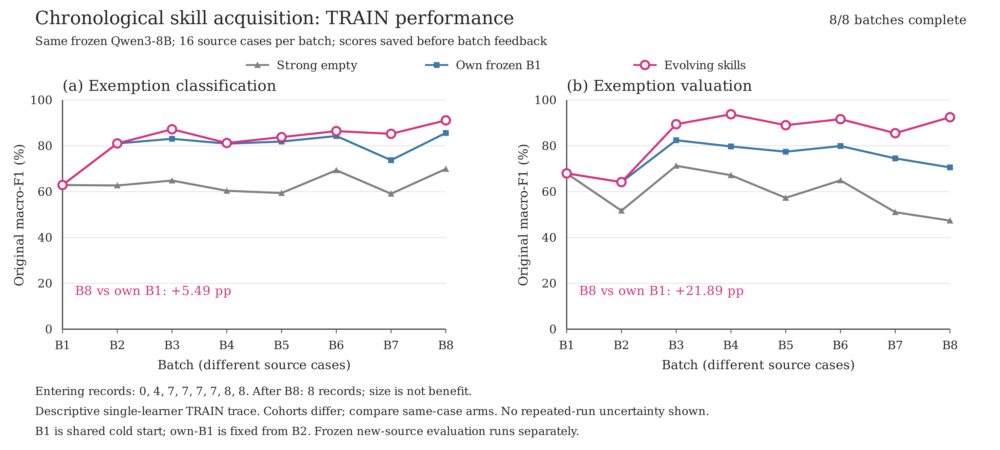
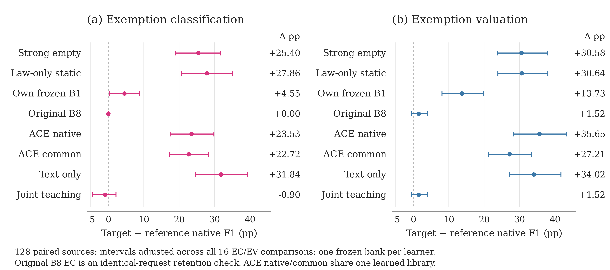

# Experimental design: experience-driven legal skill refinement

Working experimental section, 29 October 2026. The source-disjoint nine-condition
comparison is complete: all 2,304 logical predictions were saved before grading.
The selected method combines eight-cohort acquisition with bounded TRAIN-only
terminal refinement. The original v0.23 manuscript and the third-acquisition
working draft are retained as distinct versions.

## Research questions and evidence

The experiments connect chronological skill acquisition with frozen-library
utility and task-aligned refinement.

| Question | Comparison | Evidence |
|---|---|---|
| Does continued acquisition help on later sources? | Incoming library versus its own fixed B1 library | Eight chronological TRAIN cohorts; forecasts precede target release |
| Does the frozen learned library improve legal decisions on new sources? | Selected target versus strong empty, law-only static, own B1, original B8 and experience-learning libraries | Complete source-disjoint IID128 comparison |
| What does task-aligned refinement change? | Selected target versus original B8 and fixed joint continuation | Matched parent and teacher opportunities; claim-level quality and actual compute |

The last question concerns terminal refinement. A claim about the superiority
of dependency-based submission granularity requires its corresponding learning
control; the joint-continuation comparison does not substitute for that control.

## Tasks, data and information flow

The executed OpenExempt profile contains exemption classification (EC) and
exemption valuation (EV). Given case facts, public statutes and the benchmark's
allowable-law result, EC lists applicable asset–provision alternatives. EV also
returns the protected amount for each alternative. Alternatives are evaluated
independently, rather than allocated jointly across an estate.

The profile samples two to four assets and two to four domicile facts, includes
five state jurisdictions and the available federal provisions, and sets the
married-case ratio to 0.5. It disables added irrelevant facts and opinions.
TRAIN contains 128 sources, processed in eight cohorts of 16. EC and EV are two
views of each source. The prospective evaluation contains 128 new sources with
no historical source-key overlap. This is the declared conditional task profile,
rather than an official full-benchmark leaderboard configuration.

The Qwen3-8B executor remains frozen. Its library is reusable text, projected
using public task and allowable-namespace information. The executor still
decides eligibility, selects provisions and produces numeric amounts. Supplying
a skill in the prompt measures exposure, not proof that its instructions were
followed. The common reference encoding identifies literal assets and public
citations; decoding adds no legal decision or computed amount.

All forecasts for a current TRAIN cohort are saved before its original targets
are released to the teacher. This is label-assisted textual skill learning.
The teacher receives original TRAIN targets, observed answers and claim-level
feedback. A proposal is assessed on every encountered source, whereas its
communication packet is bounded. There is no separate validation set.

Acquisition and refinement teachers run in fresh, tool-free sessions from
isolated temporary directories, ignoring project rules and user configuration.
All 18 captured final responses in this learning tree match their saved
structured outputs; the event logs contain no tool-use items.

## Chronological acquisition

Evolving libraries give incoming EC/EV F1 of 82.38 / 84.25% across
TRAIN, compared with 63.58 / 59.85% for strong empty and 79.19 / 74.60%
for own-B1. Gains are 18.80 / 24.40 percentage points over strong empty
and 3.19 / 9.65 points over own-B1. Relative to own-B1, 83 of the 256 task
views improve, 24 worsen and 149 tie.

| Cohort | Strong-empty EC / EV F1 (%) | Incoming EC / EV F1 (%) | Own-B1 EC / EV F1 (%) | Published records |
|---|---|---|---|---|
| B1 | 62.90 / 67.97 | 62.90 / 67.97 | 62.90 / 67.97 | 4 |
| B2 | 62.70 / 51.70 | 81.05 / 64.17 | 81.05 / 64.17 | 7 |
| B3 | 64.85 / 71.30 | 87.23 / 89.43 | 83.07 / 82.45 | 7 |
| B4 | 60.38 / 67.18 | 81.24 / 93.77 | 80.95 / 79.73 | 7 |
| B5 | 59.41 / 57.29 | 83.80 / 89.01 | 81.87 / 77.44 | 7 |
| B6 | 69.35 / 64.93 | 86.42 / 91.64 | 84.29 / 79.92 | 8 |
| B7 | 59.10 / 51.04 | 85.24 / 85.52 | 73.74 / 74.53 | 8 |
| B8 | 69.92 / 47.37 | 91.12 / 92.48 | 85.62 / 70.59 | 8 |

Figure: Original first-encounter task macro-F1 for strong empty, own frozen B1
and evolving skills. Each point is an actual cohort result, without smoothing
or repeated-run uncertainty bands. Entering library sizes are 0, 4, 7, 7, 7,
7, 8 and 8 records. [Vector PDF](figures/third_acquisition_prequential_20261029.pdf)
and [exact source data](figures/third_acquisition_prequential_20261029.json)
accompany the figure.

Each row covers different new sources. Incoming forecasts use the library
available before learning that cohort; record counts describe the subsequent
publication. B1 is cold in both conditions. B2 uses the same B1 library in both.
From B3 through B8, both task-wise point differences are positive in each cohort.
The curve measures later-source utility, rather than monotonic performance on a
fixed collection of cases. Own-B1 measurements do not enter teacher feedback or
admission.

### Skill revisions and actual exposure

The eight publication boundaries introduce eight skill identities and contain
14 existing-record revision events, with no deletions. These are cohort-end
transitions, not teacher-operation counts. B3, B4 and B5 keep seven records while
revising four, one and two existing records, respectively. B7 retains its parent.

All 256 stored first-forecast inputs match the task-and-public-namespace
projection of the correct entering library, including the supplied skill text.
Of these, 216 contain skills. The 40 empty projections comprise the 32 cold-start
B1 views and eight B2 views with no matching record in the B1 library. Every
view from B3 onward receives nonempty skills. This establishes exposure rather
than semantic compliance.

Task-wise versions reveal information hidden by record counts. The EV
projection remains identical across the B2–B5 publications, so the B3–B6
incoming EV forecasts use the same skill version on different cases. EC edits
during that interval are not EV updates. The audit motivates tracing task-wise
content and exposure alongside scores; it does not assign causal gains to an
individual text edit or reuse the same-case interpretation for different cohorts.

## Bounded terminal refinement

The actual B8 publication is the shared parent for two completed continuations.
Its acquisition run is
`legal_openexempt_native_claim_feedback_public_assets128_20261027_run01`;
the selected continuation is
`legal_openexempt_completed128_task_consolidation_20261028_run01`.
The latter starts from that completed bank, not from the subsequent anchored-
execution build. It adds no new source cohort and is not an independent build.
The selected continuation schedules one EC-only and one EV-only teaching
opportunity. Each packet contains at most 32 task records, and edits preserve the
other task's rendered memory. A fixed joint control has two teaching
opportunities with both tasks represented in each packet. Both expose at most
32 task records per call; the joint packet has two task views per source.
Equal teacher opportunities therefore do not imply equal source coverage,
token volume or native replay cost.

The selected continuation retains the original EC state and commits an Illinois
EV revision. Its seen-TRAIN EC/EV F1 is 91.15 / 92.78%, compared with
91.15 / 91.28% for the parent. Correct EV claims increase from 797
to 813; pooled complete-claim EV F1 increases from 90.26% to 91.40%. Across 128
EV views, 12 improve, one worsens and 115 tie. These values describe refinement
on encountered TRAIN. The frozen-source results below assess new-source utility.

The target library was selected before loading prospective questions. The joint
control's actual final library is retained as a separate condition. Its EC
revision is not spliced into the target. The exact accepted states, rejected
whole proposals and both teacher-parent chains remain in the completed artifacts.

## Frozen comparison and metrics

The nine conditions are strong empty, blind law-only static, own B1, original
B8, the selected task-aligned continuation, fixed joint continuation, native
ACE, the same ACE library in a lossless common interface, and Text. The two ACE
representations share one learned library and one construction cost.

All conditions receive the same complete public task information and use the
same frozen executor and decoding profile: seed 45, temperature 0.6, top-p 0.95,
top-k 20, thinking enabled, a 32,768-token context and an 8,192-token output
budget. Four requests share one model instance. TEST invokes no teacher and
performs no skill update. Each identical complete request has one physical
response origin and explicit aliases.

All 2,304 logical predictions are saved before any prospective grading.
Native EC and EV F1 use the original scorer. Complete-output per-case F1,
format failures, extra claims and negative/unscored-asset claims complement
the native endpoints. Pooled complete-claim F1 is
`2 sum(TP) / [2 sum(TP) + sum(FP) + sum(FN)]`; incorrect amounts contribute
an incorrect prediction and an unmet target. Different aggregations retain
their own names. Missing original count fields make the affected pooled
diagnostic unavailable, rather than removing failed cases.

The target has eight prespecified contrasts, yielding one 16-endpoint family.
The paired unit is a source; EC and EV are resampled together. Intervals use
20,000 PCG64 source-bootstrap draws, seed 2026102792, with ordinary 95% and
Bonferroni-adjusted intervals. They describe the actual frozen libraries.
Additional independent learning repetitions remain deferred. The selected
target and original B8 have identical EC requests, so their EC contrast is a
retention check with structural zero difference.

## New-source frozen-library results

Experience-derived skills improve both legal tasks on the 128 new sources.
The selected library reaches native EC/EV F1 of 91.15 / 91.86%, compared with
65.75 / 61.28% for the same frozen executor without skills. It also exceeds its
own fixed B1 library by 4.55 / 13.73 percentage points. These comparisons connect
new-source utility to continued experience, rather than to having any initial
skill prompt. All four corresponding family-adjusted interval lower bounds are
positive.

| Frozen condition | Native EC F1 (%) | Native EV F1 (%) | Complete-output EC F1 (%) | Complete-output EV F1 (%) | Format failures EC / EV |
|---|---|---|---|---|---|
| Strong empty | 65.75 | 61.28 | 69.25 | 61.72 | 0 / 0 |
| Law-only static | 63.29 | 61.22 | 66.03 | 61.54 | 0 / 2 |
| Own frozen B1 | 86.59 | 78.13 | 88.92 | 77.51 | 0 / 2 |
| Original B8 | 91.15 | 90.34 | 92.77 | 89.70 | 1 / 0 |
| ACE native interface | 67.62 | 56.21 | 70.38 | 56.71 | 2 / 8 |
| ACE common interface | 68.42 | 64.66 | 70.85 | 63.91 | 1 / 1 |
| Text-only adaptation | 59.30 | 57.84 | 63.40 | 58.49 | 3 / 1 |
| Selected task-aligned target | 91.15 | 91.86 | 92.77 | 91.14 | 1 / 0 |
| Fixed joint continuation | 92.05 | 90.34 | 93.60 | 89.70 | 0 / 0 |

Table: Each entry includes all 128 sources for that task, with format failures
retained as zero scores. Native and complete-output values are per-case macro-
F1, not pooled claim F1. EC and EV share source cases. ACE native and common
interfaces use one learned library; they are representation controls, not
independent learning methods. Entries describe one actual construction per
learner under the declared conditional OpenExempt profile.
Original B8 is the eight-cohort endpoint. The selected target and fixed joint
control include separately reported post-stream learning, and their rows do
not assert a common eight-cohort-only learning budget. They do not replace the
unrefined B8 row.

The selected library exceeds the retained ACE and Text adaptations on both
native endpoints, including the ACE common interface. Its corresponding
family-adjusted lower bounds are all positive. A complete actual-input census
confirms that the retained main, ACE and Text learning chains each receive the
original targets for all 128 TRAIN sources. Their target-bearing records match
the original labels, and their teachers use the same model and reasoning effort.
The score separation therefore is not explained by exclusive label access.
It is a comparison of the executed adaptations, not an official full-benchmark
leaderboard claim or an equal-compute experiment. The construction table below
reports their differing computation.

Figure: The selected library improves both native endpoints over strong empty,
static, own B1 and the retained experience-learning adaptations. Points are
source-paired differences; bars are conditional Bonferroni-adjusted bootstrap
intervals for the prespecified family of 16 endpoints. Every contrast is shown,
including the exact-zero B8 EC retention check and joint continuation. Intervals
describe these actual frozen libraries, not independent learning-seed variation.
[Vector PDF](figures/source_disjoint_effects_20261029_v02/paired_effects.pdf) and
[exact plotted data](figures/source_disjoint_effects_20261029_v02/source_data_and_provenance.json)
accompany the figure.

Terminal refinement preserves the parent's EC responses exactly and increases
new-source EV F1 by 1.52 points. Its ordinary paired 95% interval is
[0.17, 3.08] points; its family-adjusted interval is [-0.46, 3.99]. Relative to
fixed joint continuation, the selected target differs by -0.90 EC and +1.52 EV
points, with both family-adjusted intervals crossing zero. These controls
separate the established utility of learned skills from the more specific
terminal-refinement hypothesis; they do not establish universal superiority of
task-wise continuation or of the acquisition admission granularity.

The final matrix was fixed before prospective input loading. No TEST feedback
updates the libraries, selects an EC/EV combination, or removes a failed case.
Original B8, the selected continuation and joint continuation remain separately
identified. Historical v0.23 TEST scores and historical submission-granularity
ablations belong to their own study and do not enter this new-source table.

### Publicly scoped skill exposure

Public-namespace projection improves use of the same learned skills in a
fixed-bank TRAIN intervention. Sixteen sources, two from each acquisition
cohort, were selected using public contexts and a fixed seed. The two conditions
share the selected target library, task projection, case, statutes, output
schema and generation profile. One applies the existing public allowable-
namespace filter; the other supplies every same-task skill. No teacher or
skill edit is involved, and all 64 predictions are saved before grading.

| Fixed-bank exposure | Native EC F1 (%) | Native EV F1 (%) | Complete-output EC F1 (%) | Complete-output EV F1 (%) |
|---|---|---|---|---|
| Publicly scoped | 92.50 | 91.97 | 94.49 | 92.63 |
| All same-task skills | 71.96 | 78.69 | 72.51 | 79.81 |

The scoped condition improves EC/EV native F1 by 20.55 / 13.28 points on these
16 sources. All outputs are retained, including two format failures in the
unfiltered EC condition. This intervention supports the existing delivery rule:
the executor benefits from receiving guidance within the public legal scope
already supplied by the task. It is a descriptive TRAIN exposure control using
the terminal-refinement bank, not a teacher-learning ablation, a submission-
granularity comparison, or an evaluation of the new empty-start build.

## Observed construction and measurement costs

| Condition | Native origins | Teacher responses | Teacher input tokens | Teacher output tokens |
|---|---|---|---|---|
| Strong empty | 0 | 0 | 0 | 0 |
| Law-only static | 0 | 1 | 18,773 | 3,425 |
| Own B1 | 58 | 1 | 100,689 | 6,460 |
| Original B8 | 1,329 | 14 | 2,439,708 | 57,154 |
| Task-aligned target | 1,585 | 16 | 2,642,479 | 72,252 |
| Fixed joint control | 1,745 | 16 | 2,698,853 | 71,968 |
| ACE | 896 | 423 | 11,526,040 | 405,699 |
| Text | 512 | 321 | 6,429,967 | 503,252 |

The two continuations share the original acquisition. Their individual linked
costs must not be added as independent builds: the complete two-branch study
uses 2,001 unique native origins and 18 teacher responses. Teacher reasoning
tokens are included in output tokens. Cached input is a subset of input tokens.

The selected target uses 10,713,940 native input tokens and 4,337,824 native
output tokens. Acquisition totals include 150 origins used exclusively for
own-B1 measurement. The consumed acquisition-learning portion has 1,179
origins; adding the target's 256 continuation origins gives 1,435 origins
consumed by that learning chain. Shared origins are charged once.

ACE's retained lineage has 423 teacher responses, including 366 inherited
responses and 57 fresh responses. Its complete successful lineage, including
retired work, has 911 native origins and 442 teacher responses; one timed-out
teacher attempt has unknown usage. These quantities remain separate from the
retained-state counts. The table records these executed studies, not all
project-wide method exploration. Teacher and executor costs are reported
separately rather than collapsed into an unsupported equal-compute claim.

The completed frozen comparison uses 1,836 physical native origins and 468 exact-
request aliases for its 2,304 logical predictions. Aliases are not independent
draws. It invokes no teacher and consumes 14,165,230 native input tokens and
4,619,395 output tokens. Actual elapsed time is 13 h 35 min 45 s. Failed outputs
and all original raw responses remain in the completed artifacts.

## Source anchors

- [Chronological source-paired reconstruction](../artifacts/research/openexempt_legal_scope_20261020/Third_complete8_incoming_vs_ownB1_actual256wires_both_task_gains_B3_B8_not_new_inference_20261028.json).
- [Actual revisions and task-wise exposure](../artifacts/research/openexempt_legal_scope_20261020/Third8_actual_publication_content_revisions256_prompt_delivery_task_stasis_TRAIN_20261029.json).
- [Teacher session and captured-event boundaries](../artifacts/research/openexempt_legal_scope_20261020/Main18_actual_teacher_ephemeral_toolfree_events_and_response_closure_20261029.json).
- [Completed continuation quality](../artifacts/research/openexempt_legal_scope_20261020/Completed128_joint_fixed2_terminal_actual_EC_and_whole_rejection_full_quality_20261029.json).
- [Actual construction and retired-lineage costs](../artifacts/research/openexempt_legal_scope_20261020/Retained_builds_actual_teacher_tokens_B1_prefix_ACE_lineage_retired_costs_20261029.json).
- [Final continuation accounting and source verification](../artifacts/research/openexempt_legal_scope_20261020/Continued9_actual_complete_sources_375tests_before_frozen_TEST_20261029.json).
- [Frozen comparison configuration](../configs/openexempt_continued_IID128_prospective_TEST_20261029_run01.json).
- [Source-disjoint analysis protocol](../docs/research/OPENEXEMPT_CONTINUED_BANK_SOURCE_DISJOINT_EVALUATION_20261029.md).
- [Completed new-source matrix, scores and intervals](../runs/legal_openexempt_continued_IID128_prospective_TEST_20261029_run01/completion.json).
- [Full completed matrix and preservation verification](../artifacts/research/openexempt_legal_scope_20261020/Continued_primary_new_source128_completed_all9_2304_predictions_main_and_controls_20261029.json).
- [Actual main, ACE and Text TRAIN-label delivery census](../artifacts/research/openexempt_legal_scope_20261020/Actual_main14_ACE423_Text321_retained_teacher_TRAIN_gold_delivery_census_20261029.json).
- [Completed fixed-bank TRAIN skill-exposure intervention](../runs/legal_openexempt_public_scope_TRAIN16_20261029_run01/completion.json).
- [Exposure pairs and both terminal archives verified](../artifacts/research/openexempt_legal_scope_20261020/Scope_TRAIN16_completed_all64_paired_scope_delivery_not_submission_granularity_20261029.json).

