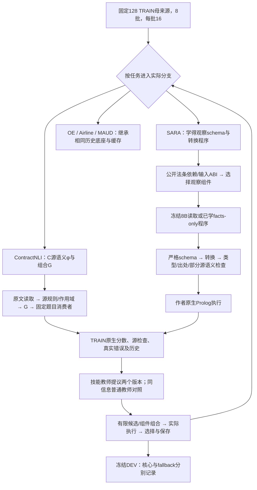

# 训练链路、中间层与学习信号复核（2026-11-15）

**结论：中间层已经压低并混淆部分学习信号；修复这些问题仍不足以解释或消除当前负收益。** 当前存在三类不同阻断：C的源语义与题目消费者不匹配；观察主路径的路由/完整性实现缺陷；模型对原文的真实误读和相对普通教师缺少额外收益。本轮没有把工程修复算作贡献，也没有重跑DEV提高分数。Goal仍active、未完成。

## 实际训练链路

权重固定；不是微调，也没有梯度优化器。更新对象是外部技能库：提示、观察schema、转换/读取程序、源语义操作和组合程序。

每批OE4、其余四库各3，合计16。这里的SARA更新驱动每批只在3个SARA母案上初答、反馈、更新和复用；两臂每批各一次教师调用、各提议两个版本，方法另评估保留版本和有限组件组合。C已有获取轨迹复用。其余三库80母/160视图继承共同FreeEvolution路径，其历史158/160视图fallback、核心正确0；这些是实际边界结果，不能称为新增三库机制学习成功。五库队列覆盖不等于五库都发生新的有效技能更新。

规划器是确定性代码，不是额外语言模型。旧规划器按静态法条传递依赖和已声明事件家族求组件覆盖，首先最少组件数，再以schema长度破平局。它并不直接优化真实语义可靠性或神经读取成本。它影响教师实际见到什么，但没有独立参数学习。

## 已暴露的问题、修复及证据边界

|问题|具体影响|当前处理及证据|
|---|---|---|
|关系输入漏路由，已确认|原生服务条款直接调用agent_/patient_，没有service_标签；只抓一元锚点时漏掉服务读取，教师再好也无法提供未被调用的组件|上一阶段已接入作者公开输入ABI；原计划C7→8、普通教师8→9个组件，来源hash与回归保留。本轮两种路由都实际选到service_events|
|全组件complete取AND，已确认|一个无关付款/关系观察未完成，可压住已经正确的教育观察；把读取范围问题混成组件学习失败|新增按原生实际事实访问范围执行。包括失败分支的每次访问均留痕；每个实际访问必须由已取得的完整家族/事件契约支撑。未知不转False；多解释分别执行且必须一致。没有把静态覆盖冒充全案关系闭包|
|宽组件/静态选择与所需输入脱节，已确认|静态覆盖可能调用6—10组件，付款和服务捆绑，增加无关生成与错误；教师反馈常只剩整案未解决|新运行在每次读取后检查原生实际残余并可停止；同样提供强直接输入路由。250fc5实际仅教育+服务两个组件，但仍被真实源错误阻断，未宣称涨分|
|执行、源真值、学习成功混为粗总分|类型与引文并不能证明角色/日期正确；原生答案偶然正确也不能给已知源误读记学习成功|保留raw native score，另分未解决、源违规、执行答错、公共计算正确、学得路径正确。源违规不能获得核心正确信用。新分类已接代码，但本轮0教师，尚未证明它提高后续学习|
|旧选择器同分偏好更少未解决，潜在偏置|正确数固定时，少一个未解决可能意味着多一个执行答错|改为先源检查、正确数，再惩罚执行答错，最后比较逻辑神经/组件读取成本。核对全部8批两臂已选候选，同源违规/同正确数的并列组中，实际受该错误数偏置影响的选择为0；不能拿这项修复解释当前分差|
|补读与主路径检查不完全一致，已确认代码缺口|旧完整适配器会再次捆绑所有组件；补读解码没有总是使用主读的精确引用约束|新补读调用同一部分观察/原生执行器，同样施加已有引用约束；已执行但答错不能改称未解决。接线已修，未新增真实补读效果证据|
|fallback掩盖主路径表现|DEV含回退6/8容易被理解成学得路径6/8|逐项单列。当前训练更新的正确分没有混入fallback；不能把DEV展示问题误报为教师已收到fallback假奖励|
|C表示与消费者合同不一致，实质阻断|受控公司员工/自身员工、请求/终止、返还或销毁/保留等区别无法靠挑已有根解决|旧完整反证复用，不重跑；不是规划器漏调一个组件。拒绝补造触发条件、强化OR或抹平法律作用域|

完整性修复保留作者条款及原有限失败语义；只在原生执行实际访问的事实范围已经取得完整观察时接受结果。否定、聚合、未绑定角色查询、多解释和先失败后成功分支均有回归。源观察契约本身仍是学得声明，不能靠执行器证明原文读取为真，因此源语义检查继续独立保留。[运行时及选择器审计](../raw/legal_skill_evolution_training_chain_audit_20261115/result.json)、[必要回归记录](../raw/legal_skill_evolution_training_chain_audit_20261115/targeted_checks.json)。

补齐最后一处补读路由缺口：已知源检查明确指出service_错误时，两种策略都优先重读这个家族，不能因另一schema较短而补读无关事件。该修改仅做离线回归，没有再请求模型；最终49项相关检查通过。[最终回归](../raw/legal_skill_evolution_training_chain_audit_20261115/targeted_checks_after_feedback_routing.json)。真实小试的冻结源码仍完整保留，其后这项补读修改没有被伪称已真实验证。

## 一次真实验证：把规划缺陷与模型错误分开

固定原TRAIN母案250fc5，保留上一轮真实学得的两个教育观察程序、原服务schema/转换器、原模型和原采样配置。先0调用验证：两臂教育程序都执行，原生残余是当前services的patient_未取得；残余路由和直接输入强控制均选择service_events。

随后两臂×两种路由共4次逻辑执行，**只新增1次物理executor请求，teacher0**；严格相同的请求共用该原始响应，四行不是四个独立样本。四条均实际经过教育→服务组件，均未通过源语义检查，不计核心成功。

原文：Alice在2017年因服务获得3200美元；另有2015-08-29至2019-05-30的入学/上课区间。服务读取把题目工作日**2017-01-01同时填为服务start_date/end_date**。该日期未由原文给出。响应格式完整，finish_reason=stop、输出273 tokens，不是8192截断；角色读取正确并不能抵消日期捏造。

这条失败现已准确记为`known_source_semantic_failure`，没有删错字段、改成null、放宽源检查或原样重发。它证明：漏路由修复已经实际生效；剩余这一条是模型事实误读。它尚未证明整个新执行器已在真实整案上成功，更不证明第二项贡献成立。两种读取策略在此选择和结果一致，没有残余读取的独立优势。

[冻结协议和源码清单](../raw/legal_skill_evolution_native_scope_pilot_20261115/protocol.json)、[0调用前置证据](../raw/legal_skill_evolution_native_scope_pilot_20261115/offline_before.json)、[四条真实执行及账本核对](../raw/legal_skill_evolution_native_scope_pilot_20261115/result.json.gz)。原始wire、响应、组件值和全部source checks均在同一raw目录。

## 哪些解释被排除，哪些仍未证明

- fallback没有进入当前M2教师更新的正确奖励；它主要混淆了总分和主路径覆盖的阅读方式。
- 教师历史压缩已做逐值往返相等检查，没有证据表明传输删掉原文、监督或错误；不能泛称上下文压缩造成学习失效。
- 历史可同时复核的保持案例没有发现B8回退；未缓存项仍是证据缺失，不能直接称遗忘或零错误。
- 普通教师同样学会了局部facts-only教育程序；已有2获取+1固定复用检查被强控制吸收。不能把程序化本身写成第二项独立创新。
- 当前DEV保持46.884%，NoC/空库48.134%；C在ContractNLI为18/32对NoC20/32。SARA方法核心正确1/8、普通教师2/8、通用5/8；旧匹配残余/普通补读各5机会均额外解决0。没有用本轮TRAIN修复改写这些冻结成绩。

因此当前失败同时包含工程缺陷、模型误读和方法增量不足；把规划器拿掉、延长训练或重跑同样批次都不足以保证改善。

## 后续最小工作及资源

先让事实获取与题目查询的职责明确：当前服务误读必须通过可复用观察/转换更新和真实源反馈解决，保留日期出处，不能靠后处理抹错。下一项必要验证仍在原TRAIN、同信息普通教师及同契约直接读取控制内；新反馈应明确区分源误读、缺输入和已执行答错。只有跨案件收益及残余读取独立作用出现，才讨论第二项方法证据。C继续处理已证明的源语义—消费者合同缺口，不能再在已穷尽根子集上延长选择搜索。二者均未成立前不启动新完整训练/DEV矩阵来赌涨分。

本轮新增1E，输入1407、输出273、总1680 tokens，服务端7.539489秒；现金发票及GPU分摊未知。累计executor10865、teacher305，reserved0，前11169条账本逐行hash一致，实际wire已核对thinking OFF、8192输出上限。原结果、错误、账本与冻结源码全部保留；没有新教师、DEV、TEST或完整训练。实现位于开发分支，main保持。
