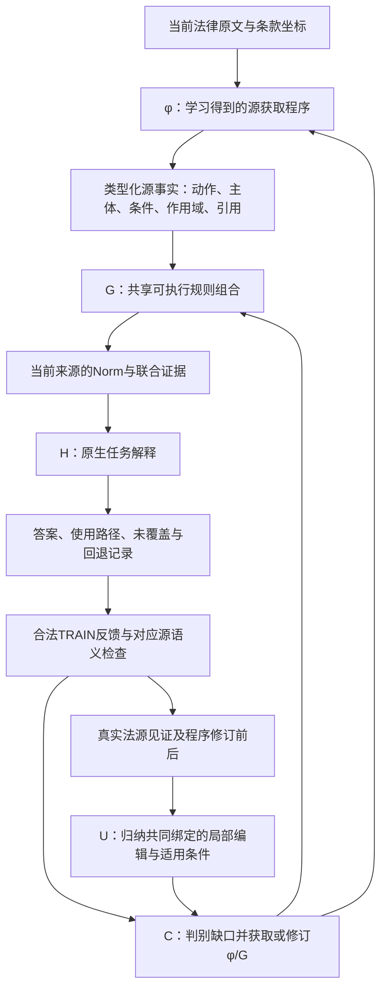

# 当前两项方法：C 与 U 的原理、算法、实现和验证状态

2026-11-14。面向当前项目的研究说明，不是论文正文，也不改变当前Goal、数据与资源授权。执行状态以[CURRENT_GOAL](../../../docs/CURRENT_GOAL.md)和[METHOD_REDESIGN_CURRENT](../../../docs/METHOD_REDESIGN_CURRENT.md)为准。

**C要学会“从法律材料取得什么规则，以及如何组合”；U要学会“有了真实修订经验，下次应该怎样改规则获取与组合程序”。** 两者都是外部技能学习，不更新律师模型或教师模型的权重。教师仍然负责提出概念、程序和修订，确定性代码负责类型、证据、搜索、执行和可复核的更新。

|方法|学习对象|当前已实现|目前尚不能宣称的结论|
|---|---|---|---|
|C：诊断驱动的开放规则学习|源语义概念与获取程序φ、共享组合规则G|真实教师获取、类型化源原子、ASP组合、有限候选学习、逐路径执行及源审查|还没有建立相对同信息强对照的稳定独立收益|
|U：法源—程序联合的更新程序学习|可跨来源实例化的编辑程序、共同参数和适用条件|typed AST编辑归纳、源/代码共同绑定、多组件编辑及守卫的代码核心|真实φ/G更新字典仍为0；尚无跨来源选用及独立收益|

这里的“创新点”是当前投入的两项**待验证方法贡献**。两项都需要真实效果和独立消融支持，不能把设计报告、代码可运行或局部样例称为已经完成。

## 1. 两项共同解决的具体问题

法律材料里的一个规则经常不在同一句里完整出现。例如，同一份合同可能把下面的信息分开写：

- 谁属于“Representatives”，以及员工、顾问、代理人是否在其中；
- 这些人员还须接受什么书面保密义务；
- 请求时应返还什么，项目结束时应销毁什么；
- 协议终止是否另有返还义务；
- 备份、单份法务留档、关联方代履行分别受什么限定。

将这些内容压成几个类别后，小模型可能输出合法JSON，却把条件绑到错误动作上。另一个问题是：修好一份材料时整体重写程序，可能把此前正确的其他解析能力一起覆盖掉。

我们的目标是学习**可执行、带当前来源和作用域的规则技能**，并让修订经验有实际复用作用。实例合同中的特定法律效果仍属于该合同，不能因为训练见过就变成所有合同通用的法律。

### 技能究竟是什么

当前技能不是一段“请仔细阅读例外”的自然语言建议。库中的主要对象包括：

|对象|内容|是否学习|
|---|---|---|
|类型和构造子|如动作、主体、触发、例外、条件、法律Norm的结构及其含义|教师可新增，类型检查由host执行|
|φ：来源获取程序|读取当前全文/条款，生成源局部事实；必要时规划小模型读取|学习、修订并保存代码|
|G：共享组合程序|连接当前来源的事实，形成可执行Norm|教师提议候选，有限约束学习选择|
|H：原生解释程序|把已取得的Norm接到各库原生问题和答案格式|版本化维护；比较时单独控制|
|U：更新程序库|带共同源参数、代码位置和适用条件的可调用编辑|当前核心已实现，真实库尚空|

训练指这些外部对象的更新。G的“优化器”是离散规则选择，不是模型梯度下降；教师调用也不是更新模型参数。

## 2. 系统中的实际分工



- **技能教师**提出φ/G及必要修订。当前教师为既定`gpt-5.6-sol/high`，没有弃用；温度未暴露，不猜测。
- **执行模型**固定Qwen3-8B、thinking OFF。在需要神经读取的路径上回答窄问题；确定性源程序已能处理的内容不重复问模型。最新两轮源程序的读取操作均为空，因此执行器新增0次。
- **确定性运行时**检查schema、名义类型、实际条款ID、程序白名单、组合和评分。它不能靠答案补造缺失规则。
- **原生评分与源语义审查分开**。答对某个NLI标签，不代表主体、期限、触发及例外都正确。

## 3. C：诊断驱动的开放规则学习

### 3.1 为什么需要它

普通生成—报错—重写能够修语法或运行错误，但不一定知道：当前失败到底是没有读到法律区别、规则组合表达不了，还是答案解释有问题。反复增加同类字段请求，可能得到更多读数而仍然无法形成正确规范。

C的研究目标是把这一决策做实：**先诊断当前程序空间能否解决错误，再把教师工作集中到真正缺少的概念、关系或组合上。** 诊断只在明确的当前假设空间内成立，不把“这组G无解”说成“模型永远做不到”。

### 3.2 学习对象与状态

一轮库状态可写为：

\[
L_t=(\Sigma_t,\phi_t,\mathcal H_t,G_t,H_t,\mathcal U_t).
\]

Σ是当前类型与构造子，φ是源获取，ℋ是有限候选组合空间，G是当前选择，H是原生解释，𝒰是更新字典。

对于当前材料D，φ产生事实F。每条事实保留自己的来源，相关字段通过scope、action identity、成员关系或引用相连。G利用这些关系产生Norm。不能把来自两个无关条款的字段仅因位置相近就拼成一条法律规则。

这里“开放”指概念和获取程序可以修订。不是把固定标签集训练到收敛，也不是预先手写全部法律规则。

### 3.3 实际算法

1. **执行当前库并保存轨迹。** 保存完整输入、源事实、候选输出、实际使用Norm、原生答案和未覆盖原因。
2. **先排除实现缺陷。** 定位schema、字段类型、构造子arity、规划器/执行器不一致及证据传递问题。只有无歧义、保持语义的适配可以由确定性代码完成。
3. **计算当前G空间的可达结果。** 对同一真实观察枚举不同G可形成的输出理论，保留实际源硬约束、明确的unknown世界和原生反馈。
4. **选择具体学习任务。** 如果现有事实与组合已经能产生正确且源可接受的结果，就修规则选择。若可达最优仍有错误，检查缺的是源概念/关系、组合bias、错误旧项还是H的解释，给教师对应原文和实际失败。
5. **教师提出真实更新。** 同信息自由强对照也独立获得同原文、监督、历史和修改能力。C可以取得新构造子、φ和G候选，不能在host里补造法义。
6. **严格编译并执行。** C的新Norm由G生成，源阶段可以保留有依据的旧Norm。若旧Norm被原文明确反证，就应修订，不能靠并列一个正确新Norm掩盖错误旧项。
7. **比较、保存与保持检查。** 记录真实路径、对应源审查、组件删除、成本及旧能力变化，保存版本后再推进。

当前G选择目标按如下顺序比较，而不是把未知补成负类：

\[
\operatorname{lexmin}_{G\subseteq\mathcal H_t}
\left(\text{合法TRAIN原生损失},\;
\text{相对实际建议先验的选择编辑数},\;
\text{规则复杂度}\right),
\]

同时满足明确源约束。当前采用自实现的有限LAS/ILP式约束学习及clingo执行，并非声称直接完整复现了原版ILASP。先验项用于避免在相同损失下任意删掉已学能力；原生反证和明确源反证仍有优先权。

**重要限定：** 全文即使在输入中，当前有限规则空间也可能不会使用它。因此可达损失下界只能定位当前`φ＋G空间＋renderer＋H`的缺口，不能单凭下界断言已证明信息论意义的表示碰撞。

### 3.4 已实现的真实跨条款例子

原TRAIN合同6fce的单位10列出Representatives成员，单位12要求其接受书面且不低于本协议的保密义务。旧C把成员许可和集体资格分开，员工/顾问/代理人的许可没有正确继承该资格。

最新真实教师产生的G中，有下列实际规则。变量写法仅把原JSON规则转为可读的关系记法：

```text
d_disclosure_scope_v4(S0, Scope, Actor, RawPermission)
d_recipient_v4(S1, Scope, Recipient, Kind, RawRecipient)
d_condition_v4(S2, Scope, Condition, Raw1, Raw2)
    => emit_permission_v4(Actor, Recipient, Condition, S0, S1, S2)
```

三个关系必须共享同一Scope。renderer用三个当前term的完整证据生成许可，实际输出带`[10,12]`，不是仅有单位10。另一类动作组合规则共享Scope和ActionID，将动作与它自己的触发、例外连接。

同一材料的单位20/21还给出独立的协议终止/书面请求返还义务。最新C已实际输出该分支，并保留24/26的例外证据。原“请求下可任选返还或销毁”的错误上游Norm已删除。de42的39/40与39/41则分别保留非成约期限和prompt请求分支；三个月限定目前以原文触发限定保存，**不称为已完成独立数值期限计算**。

在6fce的实际执行上，删除资格连接规则使原生正确从4/4变为2/4；删除处置连接规则变为3/4。说明本次真实路径在使用这些G连接。de42删除相同新规则仍4/4，存在有效旧根，不能把它也算成新增G独占成功。[真实组件干预及部分源审查](real_scope_repair/unbound_C_actual_mechanism_and_partial_review.json)。

### 3.5 C的候选差异在哪里

程序生成与符号执行已有成熟路线：[PAL](https://github.com/reasoning-machines/pal)、[LINC](https://github.com/benlipkin/linc)、[Logic-LM](https://github.com/teacherpeterpan/Logic-LLM)。Logic-LM也已经使用求解器错误反馈修订形式化，不能将“生成程序并纠错”本身作为本项目创新。

[LLM2LAS](https://arxiv.org/abs/2509.16590)已有语义结构提取到规则归纳；[SkillWrapper](https://arxiv.org/abs/2511.18203)已有生成式谓词发明；[SCOPE](https://arxiv.org/abs/2610.31062)已有神经谓词、确定性提取、组合程序和反例驱动优化。

**我们要验证的具体差异**是：固定实际法律训练池、部分法源监督下，对当前可表达性做可计算诊断；据此取得缺失的源内区别，学习具有主体、作用域、引用及联合证据的规则组合。新合同法律效果不能无条件泛化。这个组合是否带来额外获取可靠性、任务效果或同等正确性下的成本优势，需要同信息强对照证明，不能仅因这些组件分别存在就认定贡献成立。

## 4. U：法源—程序联合的更新程序学习

### 4.1 为什么C之外还需要U

C能够每次让教师重新取得和修正程序。U的目标是把已经发生过的、具有来源依据的修订变成可调用的更新技能，改善下一份材料的获取与更新。

例如，已经确认一次错误是“请求触发被错误共享给两个动作”。再次遇到相似代码时，仅复制旧补丁不够：必须确认当前来源的两个动作、各自触发和影响范围，再把当前参数送入正确编辑位置。相似代码可能对应不同法义，源参数也可能属于不同主体。

**U要学习的不是某份合同的正确答案，而是由当前法源决定如何改代码的程序。** 如果一个完整正确修复程序已经自然处理所有后续材料，且U没有精度、保持或成本上的额外作用，就不能再把它包装成独立贡献。

### 4.2 训练记录应当长什么样

一个合格事件至少包含：

```text
事件ID、母来源、合法的实际观察
修订前程序片段 P-
修订后程序片段 P+
确实支持该修订的源关系 W
源角色与代码位置之间的明确对应 M
实际适用/不适用证据、语义检查、成本
```

M不能仅靠字符串碰巧相同。例如，“当前例外作用于哪个动作”要有源见证；代码中需要修改的对象要与这个同一动作绑定。新增法律常量须有来源，不能把上次合同的数值当作所有合同的参数。

教师可以帮助取得角色与对应，host核对当前见证、类型和AST路径。若这些对应构成额外监督，也必须对强对照开放并计入获取成本。

### 4.3 更新程序的结构

拟学习的对象可表示为：

\[
U=(Q_{source},P_{code},T_{edit},g,\tau).
\]

- `Q_source`：匹配实际源关系的查询；
- `P_code`：可匹配的旧程序AST形状；
- `T_edit`：带参数的编辑模板；
- `g`：从明确正、负适用事件学习的边界条件；
- `τ`：源角色与代码参数的共同名义类型。

到新材料时，**同一替换θ**必须同时满足源匹配、代码匹配和守卫。不能源侧选甲主体、代码侧却修改乙主体的规则。

### 4.4 已有代码核心具体怎么做

当前实现采用PBE与AST反统一思路，不另造一个数学上等价的补丁归纳器：

1. **标注当前真实角色。** `source_slots`给出每个角色在源事实参数及before/after AST里的路径；先核对值与类型确实对应。
2. **反统一修订。** 对实际旧、新子树保留共同结构，将变化的源参数替换为角色；未变代码可以作为显式子树复制。新增局部变量采用安全新名字，避免变量捕获。
3. **校验新增法律字面量。** 新增法义值必须来自明确源绑定，或是已声明的固定语言/API常量，不能无依据写入模板。
4. **学习适用条件。** 在有限关系候选中找覆盖明确正事件并排除明确负事件的守卫。未知、不匹配或历史分数没变化不能自动作为负样本。
5. **联合实例化多个组件。** φ、G、renderer等组件必须在同一源参数替换上连接，先连接再去重；“生成相同代码”不代表法源见证可以提前丢弃。
6. **处理歧义。** 唯一有效编辑才安装；没有匹配返回不适用，多种不同编辑保留歧义，不选择默认参数。
7. **重走正常检查。** 修改相关组件后废止旧fit，重新检查类型、源证据和必要组合结果。编辑模板生成成功不等于法义正确。

对应接口：`learn()`、`applications()`、`learn_guard()`，以及多组件的`learn_bundle()`、`apply_bundle()`、`library_candidates()`。已有条件编码会保留字典建立成本、实际编辑及当前参数，不把模板压缩字节直接当成任务效果。

### 4.5 U预期怎样改进这一次真实问题

本次C整体替换源程序后，两份修复合同的明确源错误被修正，但其余六份保留检查丢失4个原本正确答案。目标U应能表达“在哪里改、替换什么、哪些已有能力继续保留”的局部修订，而不是要求教师每次重写整个库。

具体实现顺序是：

1. 从现在保存的真实before/after及路径中分离局部语义编辑，区分通用接口修复与有法源依据的修订；
2. 为实际编辑取得可核对的共同源—代码角色；不把两份来源上应用的同一全局程序更新算成两种参数化例子；
3. 送入现有typed编辑归纳核心，记录生成的U、适用守卫和真实支持事件；
4. 在原TRAIN中预先固定的后续真实修订上，让U使用当前来源参数构造候选，和完整正确修复缓存、错误—修复检索、普通自由更新比较；
5. 检查任务效果、源正确性、旧能力保持和全部成本，确认U是否具有独立作用。

这是待打通的实际训练闭环，**不是已经完成的实验结果**。不能通过人为删字段、拆坏旧程序或构造任务来制造U需求。

### 4.6 与已有工作具体区分

[Refazer](https://www.microsoft.com/en-us/research/publication/learning-syntactic-program-transformations-from-examples/)已经从编辑例子学习程序变换；[Getafix](https://software-lab.org/publications/oopsla2019_Getafix.pdf)已有分层修复模式及上下文选择。[EVISKILL](https://arxiv.org/abs/2610.05030)已有修订与可重放执行证据关联、定向重放及跨轮保留。

U拟验证的增量是：**法源关系与程序目标共用参数、适用范围由明确证据约束，并在当前材料直接实例化可执行编辑。** “保存补丁”“重放修改”“有适用条件”都不是单独的新主张。普通PBE若在相同联合输入上实现同一算法，应作为采用的成熟核心；真正要比较的是法律源约束是否带来额外作用。

## 5. 两项怎样分别证明，怎样避免把强对照做弱

|系统|规则获取C|更新U|用于回答什么|
|---|---|---|---|
|完整ours|诊断驱动开放获取|源—程序联合更新|完整方法效果|
|−C|同信息自由获取/普通组合优化|保留U|C的独立作用|
|−U|保留C|完整历史检索与普通自由修订|U的独立作用|
|强基础|同信息自由获取|正确完整修复复用及自由更新|组合是否超出强简单方法|

这是机制比较设计，不是本报告启动新完整评估矩阵。C建议G/重新拟合的NoFit控制用于进一步解释选择器作用，不能因为NoFit同分就把“G必须涨分”新增为第三项贡献验收门槛；但若论文声称共同拟合带来收益，就必须有其证据。

比较遵守以下口径：

- 端到端获取双方用相同原文、合法监督、历史与可比资源，独立取得规则；教师/修复/失败成本全部计入。
- 自由对照可以写完整程序、分解任务、修改谓词和组合，不限制为不会修复的弱臂。
- 共享已学规则、共享消费者只用于隔离执行/解释层作用，不冒充独立获取。
- 直接角色抽取、正确政策缓存、同材料错误—修复检索和同信息错误模型等已有强控制继续保留。
- 必要公共修复对双方开放；源对应若额外取得，也不能只给ours。
- 允许方案fallback，但留在总分母、单列使用比例及原因，不计为核心机制成功。
- 最终需要完整ours对分别删除C/U有可解释收益，并相对强基线有实际优势。代码覆盖、技能数、格式通过、部分满分和理论成本潜力不能代替。

## 6. 截至本报告的真实结果

### 6.1 固定八母源获取

C与Free各自真实教师更新后，在同8份原TRAIN合同上执行，C25/32、Free21/32。C核心覆盖25/32、Free24/32；fallback物理调用0，未覆盖保留。共享C消费者而不改Free法律项时Free23/32，说明部分差距来自H，不能把全部4题归给C获取。[逐来源及使用根](real_source_gap/source_results.json)、[共享消费者控制](real_source_gap/unbound_shared_consumer_control.json)。

当前建议G达到可证明的原生错误下界7，选择编辑0。本次再拟合无额外收益，最后未完成枚举原样保留，不用局部搜索冒称完整。[精确证书](real_source_gap/certified_revision/certificate.json)。

### 6.2 最新两母源作用域修复与六母保留检查

|固定范围|C修复前|C修复后候选|Free修复前|Free修复后候选|
|---|---:|---:|---:|---:|
|de42/6fce两母，原生正确/8|8|8|7|7|
|其余六母保持，原生正确/24|17|13|14|13|
|八母总计，原生正确/32|25|21|21|20|

C的部分对应源错误已经通过实际输出核对修正，且6fce存在真实G组件作用；native训练总分没有提升，整体替换丢失了旧能力，候选不能直接替换原库。Free同样进行独立真实修复，也有源范围改善；五个从共同任务里的C库使用、却未在自身spec声明的原子，已按**原有准确声明**导入，未映射名字、补规则或放宽类型。原始失败和原编译库保留。[全部结果](real_scope_repair/source_results.json)、[C真实语义路径和干预](real_scope_repair/unbound_C_actual_mechanism_and_partial_review.json)、[Free确定性schema恢复](real_scope_repair/FreeUpdate/unbound_schema_imports/proof.json)。

### 6.3 为什么U到现在仍没有实证

现在有真实修订前后记录，但每个学习臂只是**一份整体库更新应用于两份母来源**；不是两个不同参数化局部编辑例子。实际共同源—代码角色对应还未取得，不能将泛化源程序自动算成源参数化U。字典仍空，也没有后续实例化及相对完整修复缓存的额外收益。[实际事件诊断](real_scope_repair/unbound_U_actual_event_diagnosis.json)。

因此原因包括研究闭环尚未打通及更新粒度不合适，而不只是“训练还没跑够”。已有AST核心的软件通过不能替代这个缺口。下一步必须解决真实局部编辑、绑定与强控制比较；不继续用更多整体重写调用凑U样本。

### 6.4 当前已知费用与边界

八母获取阶段新增0E/2T，教师356915输入、43894输出token，826.159服务秒；两母修复再新增0E/2T，201230输入、34826输出token，675.810服务秒。两阶段共4次教师物理请求，执行器新增0；失败与历史记录未重置，累计10583＝10343E/240T，在途0。现金发票/GPU分摊未知。[八母费用](real_source_gap/cost_and_preservation.json)、[两母修复费用](real_scope_repair/cost_and_preservation.json)。

本报告写作不新增研究模型调用。当前新C/U版本尚未开始完整训练，旧128母实验已完成但不能替代新机制验证。五库及原数据清单不变：OpenExempt32，SARA/ContractNLI/Airline/MAUD各24，共128母/280视图。同母多个视图不增加独立来源。当前仅在既有TRAIN做有限研究，不打开TEST，不启动新完整训练、完整DEV/TEST矩阵或论文。

## 7. 当前代码与复核入口

所有链接指向本仓库源码，实际绑定版本还保存在相应结果目录的`source_snapshot/`中。

|用途|当前实现|
|---|---|
|教师提议编译、共有类型与接口|[acquisition_proposal.py](../../../legal_skill_guard/skill_evolution/acquisition_proposal.py)|
|φ观察、G学习与执行入口|[open_acquisition.py](../../../legal_skill_guard/skill_evolution/open_acquisition.py)|
|当前源事实及证据编码|[source_observations.py](../../../legal_skill_guard/skill_evolution/source_observations.py)|
|G规则、验证与求解|[relational_rules.py](../../../legal_skill_guard/skill_evolution/relational_rules.py)|
|G输出到Norm及出处|[source_composition.py](../../../legal_skill_guard/skill_evolution/source_composition.py)|
|有限G可达输出精确投影|[projected_composition_profiles.py](../../../legal_skill_guard/skill_evolution/projected_composition_profiles.py)|
|U的typed参数、AST归纳、应用与守卫|[joint_updates.py](../../../legal_skill_guard/skill_evolution/joint_updates.py)|
|U跨φ/G组件的共同绑定与候选安装|[joint_library_updates.py](../../../legal_skill_guard/skill_evolution/joint_library_updates.py)|
|实际八母获取、最优证书、证据修复|[source_gap_acquisition](../../../experiments/legal_skill_evolution_source_gap_acquisition.py)、[certificate](../../../experiments/legal_skill_evolution_source_gap_certificate.py)、[provenance](../../../experiments/legal_skill_evolution_source_gap_provenance.py)|
|实际两母源范围修复与保持检查|[source_scope_repair](../../../experiments/legal_skill_evolution_source_scope_repair.py)、[source_scope_check](../../../experiments/legal_skill_evolution_source_scope_check.py)、[source_scope_mechanism](../../../experiments/legal_skill_evolution_source_scope_mechanism.py)|
|全阶段结果与历史反证|[update_train_result.md](update_train_result.md)|

两项的当前定位不变：C已有真实源获取和局部组合执行证据，U已有可复用的编辑核心；完整的独立收益验证尚未完成。下一项工作是利用已取得的真实修订，完成有源绑定的局部更新及其强对照，而不是靠扩大完整训练来掩盖方法缺口。Goal继续active。
